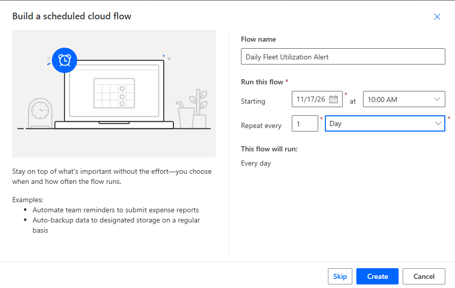
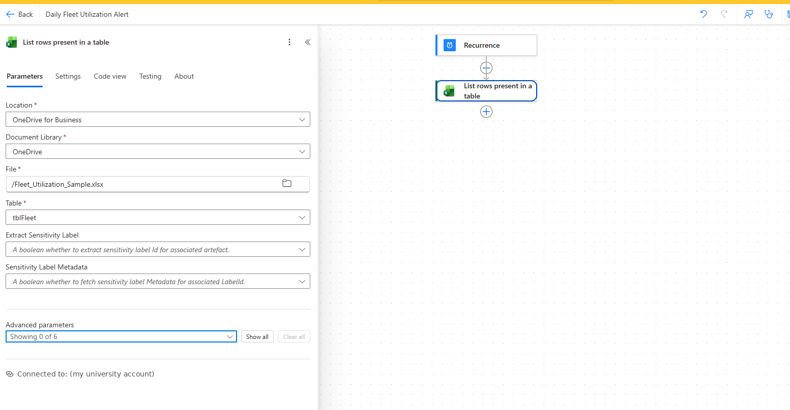
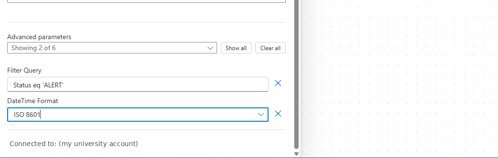
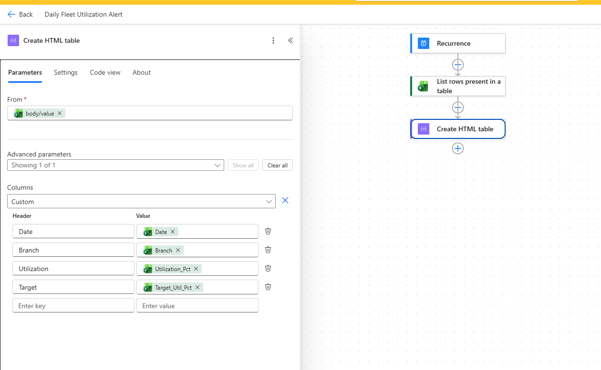
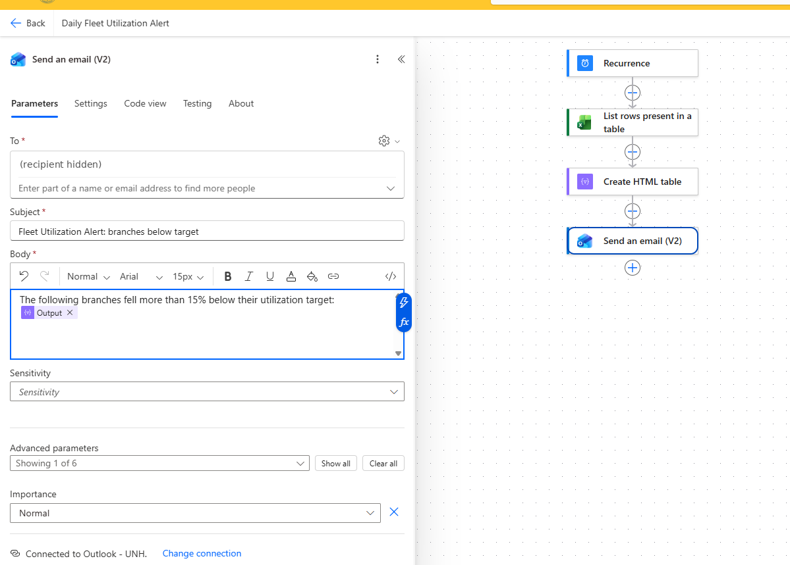
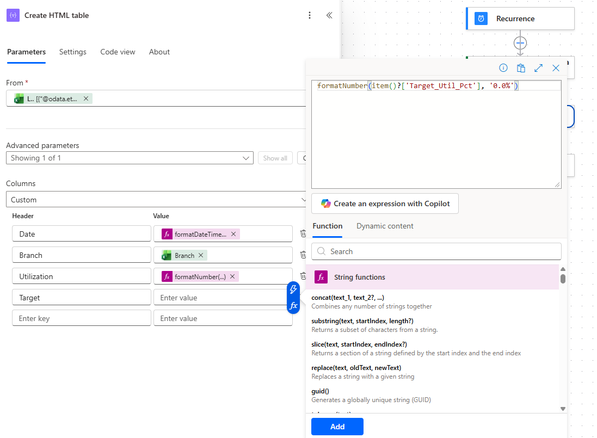
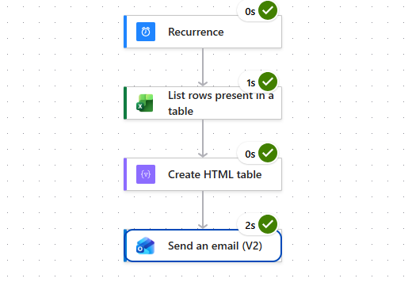
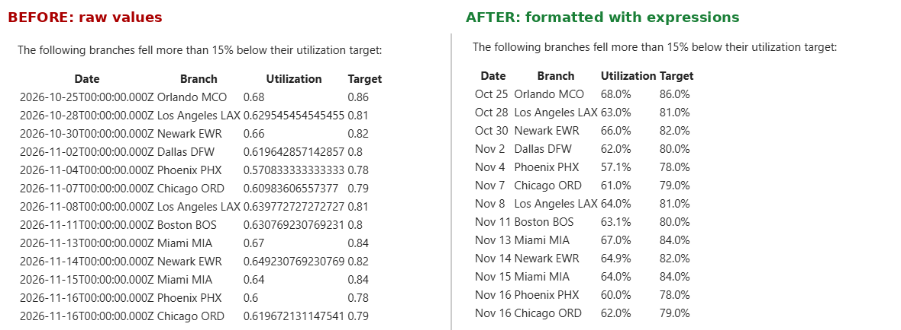

# 🚗 Daily Fleet Utilization Alert (Power Automate)

**A flow that watches branch-level fleet utilization every day and emails a clean alert table whenever a branch falls more than 15% below its target.**

No more digging through dashboards to find out a location has idle cars. The problem finds you.

> 📌 All data is **synthetic** (made up for practice). Nothing here is real company data.

## ▶️ Demo (40 seconds)

<!-- In GitHub's editor, drag fleet_alert_walkthrough_github.mp4 here. It uploads and turns into a playable video. -->

---

## Why alerts, not just dashboards

Dashboards wait for people to look at them. **Alerts reach them.**

This flow is a **threshold and exception alert**: it stays quiet until something crosses a line, then tells the right person. Here, the line is a branch falling more than 15% below its utilization target. The same pattern fits other teams too, for example telling a sales head when a region drops 15% below target, or telling ops when inventory runs low.

---

## What it does

| Without automation | With this flow |
|---|---|
| Someone opens Excel, filters, spots the weak branches | The flow does it every morning |
| Managers hear about idle fleet days later | They get an email the same day |
| Raw numbers like `0.6195` | Readable alerts like `62.0%` vs `79.0%` target |

**The idea in one line:** Excel data → Power Automate checks it daily → emails only the branches that are in trouble.

```
 Excel table (OneDrive)  →  Daily schedule  →  Keep only "ALERT" rows  →  Build HTML table  →  Email
```

## The data

`Fleet_Utilization_Sample.xlsx` has 8 airport branches over 30 days (240 rows) in four tabs:

| Tab | Purpose |
|---|---|
| `Fleet_Daily` (table `tblFleet`) | Daily fleet size, cars rented, revenue, target, and a **Status** column |
| `Thresholds` | The alert rule (15% below target), editable in one cell |
| `Exceptions_Log` | Alert history (ready for a future "log every alert" step) |
| `Analysis_Requests` | Stakeholder request tracker (ready for a future form flow) |

**Alert rule:** utilization = cars rented ÷ fleet size. A row is `ALERT` when it is at least 15% below that branch's target:

```excel
=IF(AND(D2>=Thresholds!$B$3, I2<=-Thresholds!$B$2),"ALERT","OK")
```

I put the file in OneDrive, since cloud flows can't read files that live only on a laptop.

---

## How I built it

### 1. Created a scheduled cloud flow
Power Automate → Create → **Scheduled cloud flow**, set to run **every day at 10:00 AM**.



### 2. Read the Excel table and keep only alerts
Added **Excel Online (Business) → List rows present in a table**, pointed at `tblFleet` in OneDrive.



Instead of pulling all 240 rows and filtering later, I let Excel do the filtering with a **Filter Query**, and set **DateTime Format** to ISO 8601 so dates come through cleanly:

```
Status eq 'ALERT'
```



### 3. Turned the rows into a table
Added **Create HTML table** (Data Operation), fed it the rows from step 2, and chose **Custom columns**: Date, Branch, Utilization, Target.



### 4. Emailed it
Added **Office 365 Outlook → Send an email (V2)**, with the table dropped into the body as dynamic content.



### 5. Made the numbers readable
The first email worked, but looked like a data dump (`0.619672131147541`). I wrapped each value in an expression:

| Column | Expression |
|---|---|
| Date | `formatDateTime(item()?['Date'], 'MMM d')` |
| Utilization | `formatNumber(float(item()?['Utilization_Pct']), '0.0%')` |
| Target | `formatNumber(float(item()?['Target_Util_Pct']), '0.0%')` |



> 🐛 **Gotcha I hit:** my first attempt failed with *"formatNumber expects an integer or decimal, got String"*. Excel returns numbers to the flow as text, so wrapping them in `float()` first fixed it.

### 6. Tested it
**Test → Manually → Run flow**: all four steps ran green.



---

## The result

Same data, before and after step 5:



Thirteen alerts came through, including the ones I planted on purpose (for example Phoenix and Chicago on Nov 16), so I know the filter catches what it should.

---

## What I'd add next

- **Yesterday-only filter** so the daily email contains only new alerts, not the full history
- **Log every alert** into the `Exceptions_Log` tab, so there's an audit trail
- **Analysis request form** (Microsoft Forms → tracker → notification)
- **Power BI dashboard** on the same Excel table for the bigger picture
- **Power BI data alert → flow:** Power BI can trigger a flow directly from a data alert, so the dashboard and the email alert work together

## Tools used

Power Automate (cloud flows) · Excel Online (Business) · Outlook · OneDrive
